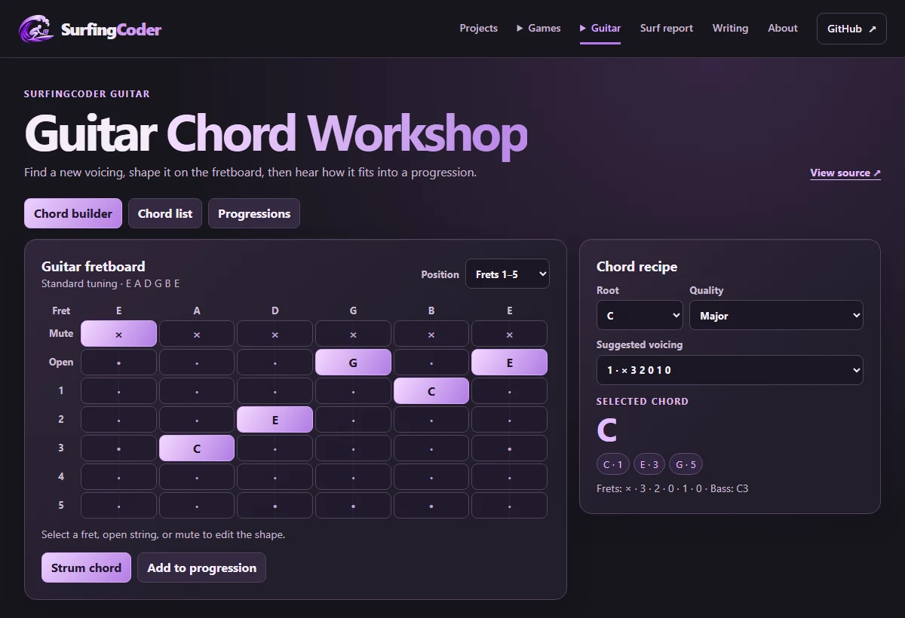

# SurfingCoder Guitar Chord Workshop

Build, identify, and audition guitar chords on a standard-tuned six-string fretboard, then assemble a progression.

[Open the workshop](https://surfingcoder.com/guitar-chords/)



## Explore chords

- **Chord builder** gives you 12 roots, 18 chord qualities, and suggested shapes. Change the position to see different frets. Click an open string, fret, or mute button to make a custom shape, see its notes and recognized chord names, and play it.
- **Chord list** shows all 18 chord types for the selected root. Choose a chord to load its recipe and suggested voicings.
- **Progressions** lets you transpose presets into any key or build a sequence from your own shapes. Play it at the tempo you choose. The browser saves your working progression locally when storage is available.

Suggested shapes favor root-position bass notes, reachable fret spans, and clean strumming lanes. Extended ninth chords can omit their perfect fifth when a full shape is impractical.

## Run locally

Start a local server and visit [localhost:8000](http://localhost:8000/).

```sh
python -m http.server 8000
```

Run `node --test` with Node.js 22 or newer to check the chord and progression rules.

The chord engine and progression definitions are in `chords.mjs`. Web Audio synthesizes the strums. The app runs locally in the browser without dependencies, an account, or a server API.
